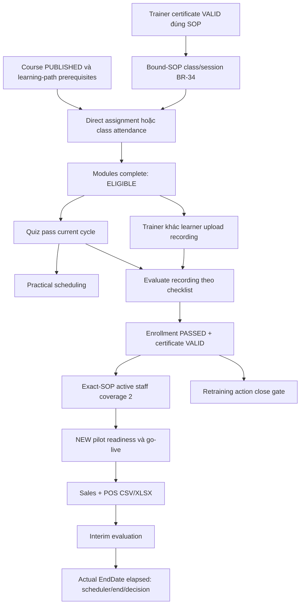

# BrewForge — post-landing review, 04/11/2026

## Kết quả hiện hành — run E2E_REVIEW_MW1K2W7N

Core online hoạt động qua browser/API thật sau merge landing:8/8 role login, một khóa test mới đi hết review→assignment→learning/quiz→practical→certificate, POS CSV/XLSX và media được chạy lại. **Chưa thể xác nhận compliance retraining đúng:** đã tái hiện gap BE G-19, action mới đóng được nhờ PASSED có trước action. Giữ ca này **FAIL**, không đổi assertion hoặc sửa BE.

| Denominator hiện tại | Kết quả |
| --- | --- |
|51 named case groups |25 PASS_LIVE_UI,7 PASS_LIVE_API,4 PASS_ISOLATED,1 FAIL,1 BLOCKED_DATA,1 BLOCKED_ENV,1 BLOCKED_TIME,11 NOT_RUN |
|191 source API operations |17 UI +38 API +1 isolated có case/variant liên kết;1 FAIL,2 blocked,132 NOT_RUN |
|66 router templates |25 có browser evidence ở role/variant đã chọn;41 NOT_RUN riêng route |
|15 Playwright tests trong lượt gộp cuối |14 pass,1 fail do G-19; một worker, không retry. Không đếm click, viewport hoặc HTTP thành workflow. |

[Registry/inventory hiện tại](final-flow-coverage.md) có ID ổn định, module/role/prerequisites/UI/API/assertion/evidence/blocker và mọi capability source. Các nhóm fault-injection là isolated; không chứng minh BE persistence/concurrency. Những số61 ca và17 ca ở phần lịch sử bên dưới không cộng vào lượt này. 132 NOT_RUN API rows phản ánh **phạm vi lượt mới**, không khẳng định các capability đó chưa từng được test.

### Git / runtime / an toàn

- FE `feat/train`, HEAD `dc5c06a1759d00e1c945b3c99abfb8e060e8df97`; `9802ec3` là ancestor, merge landing đã có. FE sạch lúc bắt đầu lượt mới. Root `main` có staged/unstaged/untracked docs/submodule state từ trước; giữ nguyên, không stage/commit/push/reset/checkout/stash/clean.
- BE `main`, HEAD `33e2ed273b7fbb91ada2c0bbaf43a3cc4a3ed9d6`, chỉ đọc, worktree sạch. Không có AGENTS.md áp dụng ở repository/parents đã kiểm. Không sửa BE/.env/credentials, không SQL/migration/seed/start BE.
- Live UI `http://localhost:5173`→API `http://localhost:5113/api/v1`. Actor helper chặn API origin khác trước login, kiểm app-config destination, context riêng theo role.8 role login/me và các GET/POST thật chứng minh kết nối/CORS; source/runtime hash hoặc schema migration identity vẫn chưa được chứng minh.
- Không bật mock flag hoặc fulfill API trong live tests. Chỉ các spec tên ISOLATED chặn real API và dùng TEST_ONLY adapter. Credential helper hiện có đọc env vào RAM; không dump, không đổi mật khẩu/role/branch tài khoản chung hoặc account19 trong lượt mới.
- Trước khóa mới/audit mới, kiểm cấu hình email chưa configured, không phát hiện process override Email/Push theo key; runtime PushConfig.enabled=false. Đây là bằng chứng trong phạm vi cấu hình kiểm tra, không phải delivery audit của process BE. Chỉ có inbox nội bộ từ workflow; không SMTP/provider send, push subscription hoặc LLM call.
- Trace/HAR/video/storageState và real-session screenshots tắt. Hai ảnh public landing1440/390 nằm trong ignored artifacts, không có identity. Export CSV được kiểm filename/stream rồi bỏ, không lưu report nhân viên. Privacy scanner bao gồm registry/operation metadata/report mới.

### Happy/unhappy thực sự chạy trong lượt này

| Module | Kết quả mới và giới hạn |
| --- | --- |
| Landing/auth | Sections/CTA8 role không auto-login, mọi anchor có target; hash/F5/Back/Forward; desktop/mobile/reduced motion/keyboard. Login sai một lần bằng identity absent của run→401/error/no session, valid login hồi phục.8 role thật qua landing Dashboard CTA, allowed page/account/F5, wrong-role redirect, logout/anonymous guard. |
| Catalog/admin | Ingredient18 mới run-owned: create/update60–90, inverted range400 không đổi saved lower bound60; UI search/sort/page-size50/page1 và navigation disabled đúng khi chỉ1 row; cuối INACTIVE. Settings chỉ list; không đổi ngưỡng dùng chung. User/branch/category/equipment/product mutation mới NOT_RUN riêng. |
| Recipe/SOP | Revalidate parent recipe16 NEW/run code và current SOP15. Rollback17 thực tế đã VALIDATED, trái checkpoint lịch sử; không ép lùi trạng thái. Chỉ dùng copy16 đã xác minh REJECTED/editable: validate200→UI report, sửa nội dung PUT200→report cũ biến mất, yêu cầu chạy lại; current released vẫn15. Sau sửa copy16 DRAFT. Full release/cutover/rollback không rerun. |
| Course/review | **Course12 mới** INDUCTION: submit rỗng409 vẫn DRAFT;7 modules có duration/lesson/question qua API_SETUP, submit→RD return comment→resubmit. RD_MANAGER duyệt qua UI200, server PUBLISHED. Không coi authoring API_SETUP là toàn bộ UI. |
| Learning/practical/cert | Assign đúng TRAINEE qua TM API_SETUP→**enrollment37**; bài đầu bằng UI, phần còn lại API_SETUP; quiz7 câu bằng UI, server pass. TRAINER upload WebM thật201→**video8**, UI checklist→PASSED/**certificate12 VALID**. Exactly1 certificate của enrollment37, assessor đúng trainer, F5. Giữ trạng thái happy, không reset để tạo negatives. |
| Checkpoint / scopes | Enrollment12 PASSED/certificate8 đúng SOP15 VALID/action3 CLOSED vẫn tồn tại; TM enrollment summary/trainee cert page thật. Other-branch audit404 và other-learner recording404, session vẫn authenticated. Lớp bound-SOP positive BLOCKED_DATA vì supplied trainer vẫn ineligible theo lookup; unbound class3/cycle negatives là lịch sử, không tính lại. |
| Media | Protected video thật load/decode640/play/seek tại4 widths, actual Range206/100 bytes; đổi SPA recording bỏ blob cũ. Synthetic fixture chỉ chứng minh kỹ thuật; UI tải blob đầy đủ trước phát. Isolated media lifecycle rerun riêng. |
| Launch/pilot | Branch1/recipe16/SOP15 vẫn LIVE, exact-version certifiedCount≥2. Pilot1 RUNNING, EndDate11/11/2026. Interim evaluation đọc được; final end/decision BLOCKED_TIME, không giả scheduler. Không tạo lại go-live hoặc withdraw. |
| Sales/POS | Reuse verified owned launch, chạy lại04-sales hiện tại: valid/partial CSV, rejected row3–8 đúng sáu nhóm lỗi, exact key/file replay; khác payload cùng key409; real XLSX→một row của ngày04/11 lưu11 cups/SOP15, aggregate11, import GUID detail/F5. Manual sale create không rerun vì row đã có; lost-response injection chỉ isolated. |
| Quality/report/utilities | Audit4 synthetic image auth decode640; skills/inbox/count/three scoped dashboards read thật; push disabled. CSV export scope course8/SOP15/branch1, filename.csv và stream>0. Không đánh dấu read inbox chung, không claim mọi filter/export variant. |
| Nghĩa vụ retraining | **Audit6/action4 mới** FAIL/G-19: prior certificate8 có trước action; assign retraining course8→ALREADY_ENROLLED/no new enrollment; không học/chấm mới; close200/CLOSED. Tên employee và retrainingRequired không bị bỏ. Gộp cuối đọc lại action CLOSED và vẫn giữ test đỏ, không tạo lại action hoặc gửi close lần nữa. |

WebM đầu vào là synthetic VP8 640×360/~2.893s, đã được generator/HTMLMediaElement kiểm ở lượt trước và tiếp tục dùng bytes thật trong upload/decode hiện tại. Có text “BrewForge automated technical test”; mọi cert/evaluation là test data, không phải xác nhận năng lực người thật. Không lấy media cá nhân từ Internet.

Dependency graph gốc bên dưới vẫn áp dụng: learning-path prerequisites → direct enrollment hoặc class/attendance → modules/current-cycle quiz → recording/evaluation → certificate → exact-SOP coverage → NEW pilot/go-live → sales. BR-34 chỉ chặn nhánh lớp gắn SOP, không tự biến direct practical thành cần certificate giảng viên giống lớp. Nhánh obligation mới cần action/cycle evidence; historical PASSED đang làm gate BE nhận sai.

### FE/UI/UX đã sửa và retest

1. Landing anchors sai/không giữ hash: target thật, offset nav, initial-hash/Back/Forward.
2. Nội dung7 roles/offline/adoption/subscription/showreel claims: cập nhật đúng8 roles, online-only, assigned-account login, label minh họa; không thêm API để làm marketing form hoạt động.
3. Reduced-motion làm hiện mọi case stats, artwork che copy/role ở mobile: sửa opacity/cột/normal-flow slot, ẩn tags trang trí mobile; kiểm ảnh public và geometry tại1440/768/390/360. Reflow720×450 là tương đương desktop200% layout, **chưa phải kiểm physical browser zoom200%**.
4. FAQ answer/illustration ARIA và local listener cleanup; Pause dừng tăng animation time; lang=en scoped landing.
5. Login home link và aria-describedby cho lỗi input; giữ hệ thống auth/session/API/Redux hiện có.
6. SOP report freshness: report gắn snapshot nội dung và version, clear/ẩn sau mutation/refetch khác nội dung; isolated repro trước fix đỏ, sau fix và live copy16 đều pass.

Chi tiết steps/expected/actual/phân loại và backlog: [product-backlog.md](product-backlog.md). Không đổi business gate, dependency hoặc permission để pass. Không xóa capability, cài dependency hoặc viết lại framework.

### Validation hiện hành

| Check | Kết quả |
| --- | --- |
| Typecheck / E2E project TS | PASS; project reference gồm e2e/tsconfig.json, có chạy compilation riêng |
| Lint | PASS |
| Node integration/authoring/session |93 PASS (37+36+20), TEST_ONLY transports |
| Production build |PASS; main463.98KB, landing45.23KB, CSS65.01KB; không có cảnh báo chunk>500KB ở build này |
| Browser shared authoring / session / public |74+11+5 PASS, isolated/public; fresh owned Vite5175 sau Node SSR checks |
| Landing/validation retest sau CSS fix |5/5 PASS trên fresh5175 |
| Lượt gộp cuối current Playwright |15 tests,14 pass/1 BE G-19 fail;2.6 phút,1 worker,0 retries |
| Privacy/Git |Password/nonpublic username/JWT/generated-password scan, ignored checkpoint, whitespace checks; BE sạch, branch giữ nguyên |

Lỗi harness đã giải quyết được giữ riêng, không đổi assertion theo behavior sai: thiếu required assignment reason400; sai tên button assessment; array field dùng bracket; invalidate tag phải là Scope/Recipes; phải mở đúng evidence tab/Fold; phải chờ login mount trước cleanup assertion. Public tests dùng footer CTA khi header đang chủ động ẩn theo scroll. Registry checkpoint đã sửa để lưu IDs không ghi đè cases mới. Course wrapper lần đầu bị ngắt đã resume enrollment37/video8, không học/quiz/upload lại mù; các pha UI của lượt này được giữ evidence, lượt gộp cuối kiểm persistence. Diagnostic COURSE-FAILURE còn historical FAIL, không cộng vào active51; **RETRAINING-OBLIGATION là product FAIL thật và vẫn tính**.

### Checkpoint, data và cleanup

`e2e-private/product-review.json` giữ runId/IDs/entity state/next/case outcomes; operation log chỉ canonical name/role/status/count, không payload. Ingredient18 INACTIVE; course12 PUBLISHED/enrollment37 PASSED/video8 evaluated/cert12 VALID giữ lại. Reused own copy16 DRAFT, current released15 giữ nguyên; rollback17 VALIDATED được để nguyên. Audit6 FAILED/action4 CLOSED sai gate được giữ để đối chiếu BE, không SQL reopen. Không có bank/stock/account mới hoặc thay credentials. Các import jobs mới thay cùng sale row về11 cups; GUID đầy đủ ở manifest của harness04, không cast thành số.

Old main chain16/15/8/12, cert8, action3, pilot1/branch1/launch10 và additional user19 vẫn được giữ; user19 ACTIVE vì coverage, lượt mới không reset password tài khoản này. Không xóa lịch sử business để “cleanup”. Chỉ dừng Vite5175 do lượt này tạo khi bàn giao; giữ FE5173/API5113 của người dùng.

### Chạy lại và phần tiếp theo

```powershell
cd D:\capstone\BrewForge\frontend
$env:E2E_ALLOW_BUSINESS_WRITES='true'
# Chọn theo checkpoint; suite này cố ý còn đỏ ở BE G-19.
npx.cmd playwright test --config=playwright.final-flows.config.ts 04-sales.spec.ts 08-retest.spec.ts 12-landing-review.spec.ts 13-live-review.spec.ts 14-course-review.spec.ts 15-validation-review.spec.ts 16-sop-utilities-review.spec.ts 17-retraining-obligation.spec.ts isolated-media.spec.ts
node scripts/report-product-review.mjs
node scripts/verify-final-flow-privacy.mjs
```

Public/isolated read-only: chọn12/15/isolated-media.08 là checkpoint/media API-read; live login/logout vẫn tạo session.13 owned catalog,14 fresh/resume course,16 owned SOP edit/report export và04 POS là business writes.17 khi action4 đã CLOSED chỉ xác nhận finding từ checkpoint, không gửi lại close; để kiểm bản BE sửa cần một action mới và workflow/cycle đúng, không thay IDs bằng dữ liệu chưa rõ ownership. Không chạy01–11 mù trên các entity CLOSED/LIVE.

Top5: **(1)** BE G-19 obligation/cycle, **(2)** deployment build/schema identity, **(3)** authorized second TRAINER để mở bound-class positive, **(4)** final pilot sau EndDate11/11, **(5)** refresh-revocation policy và stale impact preview. Notification context/history/report clarity là bước cải thiện sau đó; stock/offline chỉ mở rộng khi có người dùng và contract đã chốt. Acceptance/dependencies trong backlog; chưa tự triển khai phân hệ mới.

---

# Lịch sử lượt tiếp tục trước merge landing — 04/11/2026

Đã tiếp tục checkpoint `E2E_MW18Y5RK`, hoàn thành practical/video/certificate, đủ coverage **2/2**, go-live món **NEW**, sales/POS thật và đóng corrective action retraining. Hai nhánh còn BLOCKED: scheduler/end/decision phải chờ ngày kết thúc pilot; lớp gắn SOP cần thêm giảng viên được phép để chứng nhận giảng viên hiện có. Không tuyên bố đã kiểm thử toàn bộ ứng dụng.

Registry của lượt tiếp tục có **61 ca luồng**: **21 PASS_LIVE_UI, 37 PASS_LIVE_API, 1 PASS_ISOLATED, 2 BLOCKED, 0 FAIL**. Đây là ca có tên và assertion; số lần chạy file Playwright, HTTP và clicks không cộng vào tổng này. 17 ca baseline trước đó được giữ riêng, không cộng lại hoặc coi như vừa chạy lại.

Bảng đầy đủ: [flow registry, prerequisites, source operations và router inventory](final-flow-coverage.md). Checkpoint riêng: `frontend/e2e-private/final-flows-manifest.json`; ID, quan hệ, trạng thái và bước tiếp theo được lưu sau mỗi luồng. Không lưu credentials hoặc auth state.

## Môi trường và phạm vi

- Root `main`; FE `feat/trainflow`, HEAD `e9e74aff309bb06f7707407a71fb142a2e92f7c6`; BE HEAD `33e2ed273b7fbb91ada2c0bbaf43a3cc4a3ed9d6`. Giữ thay đổi staged/unstaged/untracked hiện có. BE chỉ đọc và worktree vẫn sạch. Runtime không công bố build hash, nên không dùng HTTP thành công để khẳng định build đang chạy trùng HEAD.
- Live FE `http://localhost:5173`, API `http://localhost:5113/api/v1`; destination được kiểm tra trước login/writes. Dùng tám role đã cấp, context riêng, một worker, không retry tự động. Người vận hành xác nhận DB test riêng, business writes và cho phép thêm một TRAINEE run-owned. Không sửa BE, `.env`, credentials, DB/clock; không migration/seed/start BE hay commit/push.
- Kiểm tra channel: email trong cấu hình hiện có chưa được cấu hình; không có Local/launch/inherited override được phát hiện trong phạm vi kiểm tra; runtime push disabled. Đây là bằng chứng cấu hình, không phải chứng minh delivery bên ngoài. Không subscribe/send push, không gọi LLM/email provider. Inbox nội bộ có thể được tạo bởi workflow; chỉ đánh dấu đọc inbox tài khoản phụ do lượt này tạo.
- Real sessions tắt trace, screenshot, video, HAR, storageState. Helper chỉ lưu tên operation/role/status/counter; không lưu headers, body hay URL chứa danh tính. Context được đóng trước lỗi đã chuẩn hóa. File CSV báo cáo được đọc stream để xác minh rồi bỏ, không lưu tên nhân viên.

## Dependency graph và các nhánh hợp lệ



Direct assignment không bị buộc vào lớp. BR-34 kiểm certificate giảng viên khi thêm session của lớp gắn SOP; lớp INDUCTION không gắn SOP có nhánh hợp lệ riêng. Recording được BE cho phép khi ELIGIBLE trước quiz; scheduling/evaluation còn kiểm quiz. Không đổi gate để ép mọi nhánh giống nhau.

## Kết quả chính trên server thật

| Luồng | Bằng chứng và giới hạn |
| --- | --- |
| Practical | Reuse enrollment12/course8/SOP15, xác minh current cycle/quiz. Không video →409; UI tạo schedule2; file TXT bị FE chặn; WebM thật upload201. |
| Playback | Protected media load/play/seek qua UI; 1440/768/390/360px không tràn trang. GET Range bytes0–99 thật trả206, đúng100 bytes và CORS expose Content-Range. UI hiện tải blob đầy đủ trước phát; không khẳng định UI stream từng đoạn. |
| Evaluation/certificate | UI chọn video1, checklist và submit bằng TRAINER. Server tạo evaluation1, enrollment12 PASSED, certificate8 VALID; đúng learner/enrollment/SOP/assessor, issuer có giá trị. Double-click ở UI và refetch không tạo thêm certificate cho enrollment này. Trainee xem/F5 giữ kết quả. Schedule2 đã COMPLETED qua UI sau đánh giá. |
| Retraining | Reuse action3/audit3. Baseline close409 RETRAINING_INCOMPLETE; sau lần pass hiện tại, close thật trả CLOSED. Không bỏ employee hoặc tắt retrainingRequired. Ca này không chứng minh BE đã sửa nguy cơ dùng PASSED lịch sử để đóng action mà không học lại, finding trước vẫn cần xác nhận yêu cầu nghiệp vụ. |
| NEW pilot | recipe16 origin NEW, SOP15 RELEASED; pilot1 tạo API_SETUP, start qua public API, RUNNING, minCertifiedStaff giữ2. Server lúc đầu đếm1/2 và từ chối go-live409; start lặp409, ROLLOUT sớm409 BR-27. |
| Coverage/go-live | ADMIN tạo TRAINEE19 theo phép bổ sung; API_SETUP học INDUCTION course9/enrollment14 trước PRODUCT course8/enrollment17. Hoàn thành lessons/quiz/video/evaluation qua public workflow; server cấp certificate9/10. Readiness đếm2/2 distinct active staff đúng SOP; UI go-live200, launch10 LIVE. Không gọi cả chuỗi học setup này là UI pass. |
| Sales/POS | UI tạo sale1 5 cups; CSV hợp lệ accepted1/rejected0; partial accepted1/rejected6, đối chiếu row3–8: duplicate, mã món lạ, ngày31/02, số âm, trước LIVE, tương lai. Real XLSX accepted1, cuối cùng chỉ một row branch/drink/day lưu11 cups, SOP15; aggregate11 và F5. |
| Idempotency | API helper gửi lại đúng file và key lấy từ submission UI → cùng job/replayed=true; đổi payload cùng key →409 IDEMPOTENCY_KEY_MISMATCH. Không thay key để né conflict. Lost-response UI được kiểm riêng bằng TEST_ONLY regression, không coi như bằng chứng live race. |
| Import history | Giữ nguyên GUID job ID; ImportResult GET thật và UI deep link/F5 hiển thị job/accepted1. Lần retest POS vẫn thay thế cùng row test về11 cups, không tạo duplicate row. |
| Pilot evaluation | Interim RUNNING evaluation đọc đúng branch cupsTotal11. StartDate2026-11-04, EndDate2026-11-11 theo GET thật. Final scheduler/end/decision chưa chạy; đợi sau EndDate theo thời gian server, dự kiến từ12/11, kiểm lại state trước quyết định. |

Fixture tạo bằng Chromium canvas/MediaRecorder: WebM VP8 thật, 640×360, khoảng2.893s/33KB; kiểm container, decode/play/seek bằng HTMLMediaElement trước upload. PNG synthetic cùng kích thước. Hiển thị “BrewForge automated technical test”, không có người thật hoặc PII. Mọi evaluation/certificate ở đây là **test data kỹ thuật**, không chứng minh năng lực nhân viên. Không dùng mock response trong các luồng live.

## Luồng phụ và negative cases

- Course return/comment/resubmit/RD approve; lớp INDUCTION course10/class3/session1/PRESENT attendance, sau đó class CLOSED. Learning-path prerequisite được đọc từ server và hoàn thành hợp lệ.
- Quiz sai/retake đến LOCKED, TM reset, học/quiz lại. Recording4 cycle cũ bị evaluation409 và không xuất hiện trong options UI. Practical fail chưa có certificate; reuse recording đã chấm bị409; recording mới pass có certificate11. Reschedule/cancel/recreate/complete lịch trên enrollment phụ.
- Wrong owner video404, TRAINEE upload403; bound-SOP session của trainer chưa được chứng nhận trả409 BR-34, class4 riêng đã CANCELLED. Wrong-branch audit404/sales403. Deactivate chỉ user19 làm session cũ401; ADMIN khôi phục ACTIVE, login mới và coverage2 được xác minh.
- WebM200MiB+1 có EBML padding bị FE chặn trước POST; chọn lại33KB upload201 đúng một lần. Enrollment19 riêng sau đó CLOSED, F5 không còn upload CTA. File oversize riêng đã xóa.
- Question bank create/copy/update/delete, question đã copy giữ nguyên; recipe copy draft16 manual repair/submit/reject, rollback draft17 chưa release. Current SOP15 của món LIVE giữ nguyên.
- Legacy recipe14 đã xác minh ownership và không có pilot active: release source18 hợp lệ làm course6 OUT_OF_DATE, rebuild→DRAFT trên source mới. Nhánh này độc lập với món NEW đang LIVE.
- Unused ingredient17: update range hợp lệ, range đảo400, deactivate; impact empty run commit thật và repeat409/UI bỏ action lặp. Category241/equipment8/product1 CRUD/lookup rồi INACTIVE; product trỏ đúng current SOP15. Empty branch4 update/close→CLOSED, roles8 và explicit user-ID lookup thật.
- Audit4 PASSED với PNG upload201, protected image decode640 ở360px; owned inbox read/read-all/unread0; compliance CSV UI có filters course8/SOP15/branch1, filename.csv và stream không rỗng. Skills.Mine, training/branch/course dashboards query thật có scope. Không coi đó là kiểm hết mọi filter/sort/page hoặc XLSX report export.

Inventory chứa **191 source API operations**, trong đó **108** có case/variant liên kết (29 UI,79 API), **83 NOT_RUN** có lý do; cùng **66 route templates** từ router/resource/report bindings. Đây là số source capabilities, không cộng vào61 ca luồng. Route có API evidence nhưng chưa có assertion browser riêng vẫn NOT_RUN ở bảng route. Stock API-only, external push/LLM, withdraw/cancel pilot đang LIVE, full trace/profile/history và các biến thể chưa kiểm đều được giữ rõ giới hạn. Auth F5/deep link/refresh/logout/race và layout có hồi quy isolated riêng; không đổi nhãn thành live chỉ vì test pass.

## FE fixes và phân loại findings

1. **FE: stale protected media khi đổi route.** TRAINER load video1 rồi SPA sang recording khác; trước sửa, blob của video cũ vẫn hiển thị, không yêu cầu tải nguồn mới. Repro thất bại trong isolated test sau khi sửa các lỗi helper. `ProtectedMedia` nay remount theo operation/params/kind, abort request cũ và revoke object URL; bỏ kết quả đến sau abort. Isolated repro và live SPA switch đều pass, recording mới decode640, mobile360 vừa trang.
2. **FE/UX: notice practical direct assignment.** Notice cũ luôn nói phải phụ trách lớp/session; nay phân biệt direct enrollment và class enrollment, vẫn nói rõ uploader đánh giá và BE kiểm gate. Live enrollment12 retest pass.

Không có lỗi BE mới được xác nhận từ các denial nói trên. BR-34, BR-27, current-cycle/video ownership, idempotency mismatch là expected denials. Không gọi việc direct assignment không đòi trainer certificate giống class là bypass do FE.

Các lần chạy harness thất bại được giữ ở `kind=diagnostic`, không tính vào active61 ca: Fold chưa mở, helper chạy trước auth bootstrap sau full navigation, sai role cho Product/dashboard, sai expectation INACTIVE cho Branch. Helper đã dùng cùng single-flight bootstrap của app; sửa actor/status theo source controller, giữ các assertions và chạy lại đến pass. Hai diagnostic rows lịch sử vẫn còn FAIL trong checkpoint để audit, không phải hai product failures bị bỏ qua. Job locator từng bị parse GUID thành số; harness đã giữ nguyên GUID và retest import history, locator số cũ được đánh dấu **không phải server ID**.

## Kiểm tra cuối

| Kiểm tra | Kết quả |
| --- | --- |
| `npm run typecheck` | PASS |
| `npm run lint` | PASS |
| `npm test` | PASS93: integration37, authoring36, session20, TEST_ONLY transports |
| `npm run build` | PASS; main chunk558.40KB, cảnh báo >500KB còn tồn tại |
| `node scripts/browser-authoring.mjs` | PASS74, isolated transport |
| `node scripts/browser-session.mjs` | PASS11, isolated HTTP interception |
| `node scripts/browser-smoke.mjs` | PASS5, public/login |
| Final-flow Playwright | 11 file live đã chạy đến pass riêng; isolated-media pass. File08 và04 được retest sau các thay đổi/checkpoint cuối. Không tuyên bố một lần replay cả suite từ đầu pass. |
| Privacy/checkpoint | Quét passwords/usernames cấu hình, JWT và generated-password patterns; không có auth captures; dữ liệu private ignored |
| Git | Diff whitespace check pass; root/FE branches giữ nguyên, BE worktree sạch |

Browser hồi quy chạy trên Vite riêng `127.0.0.1:5175 --force` sau Node SSR checks; không dùng stale HMR instance và không gửi business HTTP thật. FE5173 và API5113 do người dùng vận hành được giữ nguyên.

## Dữ liệu giữ lại và tiếp tục

| Entity | Checkpoint |
| --- | --- |
| Happy chain | recipe16/SOP15/course8/enrollment12/PASSED/evaluation1/certificate8 VALID |
| Pilot/launch/sales | pilot1 RUNNING, branch1, threshold2, launch10 LIVE, sale1 final11 cups |
| Retraining | audit3/action3 CLOSED |
| Additional learner | user19 ACTIVE; course9/enrollment14, course8/enrollment17 PASSED; certificate9/10 VALID |
| Secondary lifecycle | course10/class3 CLOSED/enrollment18 PASSED/certificate11; class4 CANCELLED |
| Upload guard | course11 PUBLISHED/enrollment19 CLOSED; small video retained, oversize local fixture removed |
| Auxiliary | ingredient17/category241/equipment8/product1 INACTIVE; empty branch4 CLOSED; audits4/5 retained |
| Version/impact | draft16 REJECTED, rollback17 DRAFT; legacy source18 RELEASED/course6 DRAFT rebuilt; empty impact COMMITTED |

Question-bank owned item đã DELETE qua API; bản copy trong course giữ lại. Không xóa lịch sử học/certificate/sales/audit. Extra learner giữ ACTIVE để coverage không tụt. Password tài khoản này chỉ sinh trong RAM; resume có thể ADMIN reset **chính owned account19** qua API sau xác minh identity, không sửa credentials chung hay file env. Không cleanup bằng SQL.

Lệnh và điều kiện chạy: [final-flows README](../e2e/final-flows/README.md). Chọn file theo manifest; không chạy mù toàn bộ mutating suite trên các trạng thái CLOSED/LIVE. Bước tiếp theo: sau EndDate, GET pilot1/readiness/evaluation, xác minh scheduler đã ENDED rồi quyết định bằng đúng role; giữ coverage2 và sales11. Bound-SOP class positive cần một TRAINER bổ sung được phép hoặc certificate trainer đúng SOP đã cấp qua workflow bình thường. Không tự mở rộng phép tạo TRAINEE thành phép tạo TRAINER.
